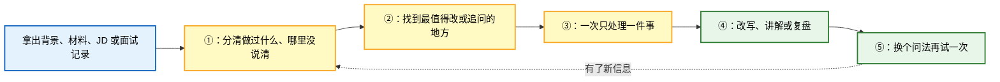
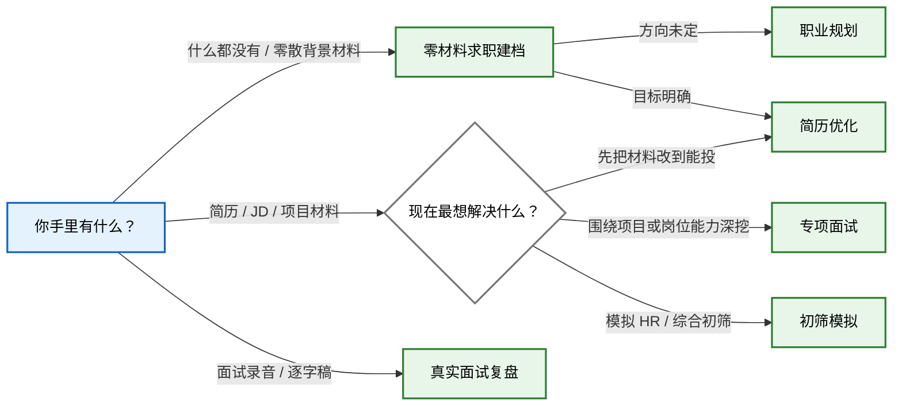

<div align="center">

# 橙子简历

### 不只改简历，陪你把找工作这件事做对。

[](https://chengzicv.com)
[](https://github.com/chengzicv/chengzicv-career-skills)
[](https://github.com/chengzicv/chengzicv-career-skills/blob/main/LICENSE)

[免费优化简历（无广告、无水印）→](https://chengzicv.com) · [查看开源修改方法论 →](https://github.com/chengzicv/chengzicv-career-skills)

<sub>20+ 次迭代 · 500+ 份简历修改 · 100+ Offer</sub>

</div>

# ChengziCV Career Skills

> 1 个求职导航入口与 6 个面向中文求职场景的 Agent Skills：零材料求职建档、职业方向、简历与作品集、专项面试、初筛模拟、真实面试复盘。

每个 Skill 都可以单独使用。没有简历时可以先从背景、大作业、PPT、奖状和证书开始建档；已经有简历、JD、项目材料或面试记录时，交给对应入口就能直接开始。

## 为什么做这套 Skills？

很多求职工具拿到简历就开始润色。句子是好看了，但里面哪些是你真做过的、数字怎么算的、面试官继续追问时怎么解释，往往没人管。

这套 Skills 的做法慢一点，也实在一点：没有简历时先把零散背景和材料整理成可继续补充的求职档案；有材料时先看真实做过什么，再看目标岗位会关心什么。简历能先改就先改，缺信息时一次只问一件事；面试先让你自己答，答完再追问、讲解和复测；复盘时尽量回到你的原话，不凭感觉下结论。

不知道可以说不知道，记不清可以跳过。它不会把参考案例里的数字塞进你的简历，也不会因为某项能力没问到，就直接说你不行。

## 它是怎么做的？

说白了，就是下面几步：



不是套一遍固定话术就结束。哪里没说清，就继续问哪里；学过的内容，再换个问法看看是不是真的会了。

## 这套 Skills 能帮你完成什么？

总入口负责判断先做什么，六个执行入口各做一件事：

| 你的任务 | 使用的 Skill | 你会得到 |
| --- | --- | --- |
| 不知道该从哪一步开始，或希望按完整链路推进 | `chengzicv` | 根据材料和期限选择当前入口，并直接开始 |
| 没有简历、材料零散，想先把背景和经历建档 | `chengzicv-profile` | 可持续补充的档案快照、材料索引、待确认项和下一步 |
| 处理职业方向、岗位取舍、转行与现实入口 | `chengzicv-career` | 当前决定、少量方向假设和第一轮现实验证 |
| 整理或改写简历与配套材料 | `chengzicv-resume` | 一版能投的简历；经历证据不够时，再一题题补齐 |
| 针对项目、岗位知识或业务 Case 连续深挖 | `chengzicv-interview-practice` | 连续追问；问清后再反馈、讲解和复测 |
| 完成一场五题左右的企业初筛模拟 | `chengzicv-interview-mock` | 一场短模拟、企业视角复盘和针对性复练 |
| 复盘已经发生的真实面试 | `chengzicv-interview-review` | 逐题还原、表现诊断和下一次可以怎么答 |

## 我现在该选哪个入口？

这张图只解决一个问题：你现在该从哪个 Skill 开始。



- 求职总入口：`$chengzicv`
- 零材料求职建档：`$chengzicv-profile`
- 职业规划：`$chengzicv-career`
- 简历优化：`$chengzicv-resume`
- 专项面试：`$chengzicv-interview-practice`
- 初筛模拟：`$chengzicv-interview-mock`
- 真实面试复盘：`$chengzicv-interview-review`

推荐主线是“零材料建档（可选）→ 职业方向（方向不清时）→ 简历与作品集 → 初筛或专项训练 → 真实面试复盘 → 按反馈回补”。不用按固定顺序走，眼下需要什么就从哪个入口开始。

## 安装

### 推荐：Codex、Claude Code、WorkBuddy、CodeBuddy 与其他支持 Skills 的 Agent

在终端执行，或者把下面这条命令发给能够操作终端的 Agent：

```bash
npx -y skills add chengzicv/chengzicv-career-skills -g --all
```

这会安装 7 个求职 Skills 和 1 个更新入口。安装完成后重启客户端，直接说：

```text
用 ChengziCV 帮我判断现在最该先处理哪个求职问题。
```

### 不想使用命令行

[下载最新版 ChengziCV Skills 安装包 →](https://github.com/chengzicv/chengzicv-career-skills/releases/latest/download/chengzicv-career-skills.zip)

解压后，按照包内说明将各个 ZIP 导入 WorkBuddy 或其他支持本地导入的客户端。外层安装包里已经把每个 Skill 单独打包，不需要再判断哪些文件夹该导入。

## 更新

已安装时，直接对能够操作终端的 Agent 说：

```text
更新 ChengziCV Skills
```

`chengzicv-update` 会重新同步官方仓库，不修改其他来源的 Skills，也不处理你的简历、档案或面试材料。当前客户端不能执行终端命令时，重新下载最新版安装包并导入即可。

## 安装后怎么开始？

不需要背复杂指令，交材料并说清当前目标即可：

```text
用 $chengzicv 判断我现在最该先解决哪一个求职问题，并直接带我开始。

用 $chengzicv-profile 从零建立我的求职档案。可以先读取我上传的大作业、PPT、奖状和证书；我说暂停时，给我一份当前档案快照。

用 $chengzicv-career 帮我把当前职业困惑拆成可验证方向，并给出下一步现实验证。

用 $chengzicv-resume 看这份简历和 JD。先给我一版能投的，再告诉我哪段经历最值得补证据。

用 $chengzicv-interview-practice 根据我的简历直接开始专项面试。先考后教，一次只问一个问题。

用 $chengzicv-interview-mock 根据我的简历开始一场企业初筛模拟。

用 $chengzicv-interview-review 复盘这份面试逐字稿。先告诉我表现，再把问题和回答逐题整理出来。
```

## 推荐什么客户端和模型？

这套 Skills 比较吃模型。只推荐三种用法：

1. **Claude Code**：选当前最新的 Claude Opus 或 Sonnet，打开 Thinking，强度选 `High` 或 `Max`。
2. **Codex**：选当前最新的 GPT 模型，推理强度选 `High` 或 `Max`。
3. **国内客户端**：优先使用 [WorkBuddy](https://www.workbuddy.cn/)，模型选择 DeepSeek（DS）、Qwen（通义千问）或 GLM（智谱）当前可用的最新旗舰版本，并打开 Thinking、深度思考或最高思考强度。Kimi K3 放在其次；按我们的实际测试，Kimi 偶尔会补出材料里没有的事实，用完记得多核对一下关键事实。

目前不推荐豆包、元宝等模型或普通聊天入口。它们如果不能完整安装 Skill、读取仓库里的配套文件，就算模型名字一样，也可能只执行了最外面那几句话。

## 它会不会替我编经历？

不会。经历、数字、结果和个人贡献，只能来自你提供的材料或现场回答。

- 简历里的待确认信息和教学案例，不会被当成真实经历。
- 面试诊断尽量回到你的原话，不凭表达印象下结论。
- 没问到的能力不会被直接判低分。
- 通用参考答案不会被倒写成你的项目做法。

## 隐私数据会保存到哪里？

这些 Skill 不包含真实候选人数据，也不会把材料写进 Skill 源码、示例或公开仓库。普通聊天只使用当前对话里能看到的内容；建档时可以随时导出一份可复制快照，但不能在没有 Runtime 或用户明确保存的情况下承诺跨会话记忆。如果接入其他产品，数据怎么保存由对应产品决定。

求职材料通常包含姓名、电话、邮箱、教育经历和工作记录。使用前请确认所用平台的数据政策，不要把未脱敏的候选人材料提交到不受信任的服务，也不要把真实面试记录直接提交到公开 issue、公开日志或示例文件中。

## 使用边界

- 这是候选人训练与材料整理工具，不代表任何企业的内部录用标准。
- 不输出录用概率，也不承诺使用后一定通过面试。
- 不依据性别、年龄、籍贯、婚育、健康、民族、宗教或政治倾向作负面判断。
- 初筛模拟不替代算法、编码、系统设计或岗位专家 Case。
- 涉及时效性规则、法律、财税、平台政策或其他高风险专业判断时，应先核验可靠来源。
- AI 生成内容仍需人工核对，尤其是数字、个人贡献、技术实现和可外发材料。

## 项目结构

```text
.
├── chengzicv/
├── chengzicv-profile/
├── chengzicv-career/
├── chengzicv-resume/
├── chengzicv-interview-practice/
├── chengzicv-interview-mock/
├── chengzicv-interview-review/
├── chengzicv-update/          # 官方 Skills 更新入口
├── tools/                     # Release 安装包构建工具
└── README.md
```

每个目录中的 `SKILL.md` 定义触发条件和核心工作流；`references/` 保存按需加载的方法与模板；`scripts/`、`schemas/` 和 `runtime/` 只在对应 Skill 需要确定性校验或产品集成时使用。

## 许可证

本项目采用 [MIT License](LICENSE)。
