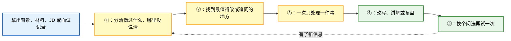
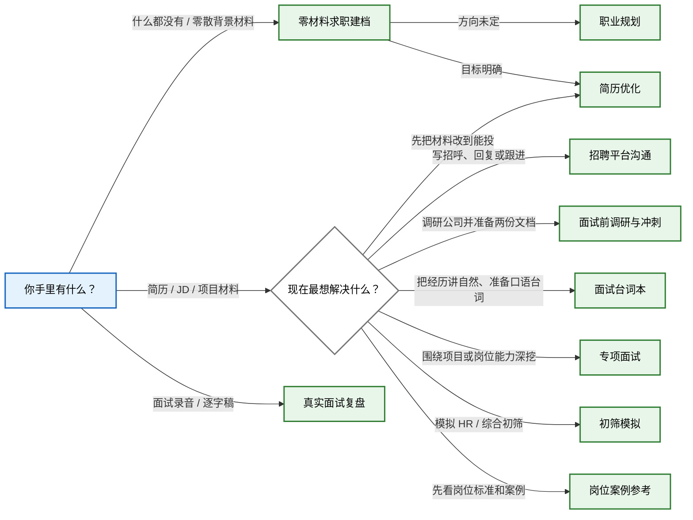

<div align="center">

<a href="https://chengzicv.com">
  <picture>
    <source media="(prefers-color-scheme: dark)" srcset="assets/chengzicv-logo-dark.webp">
    <source media="(prefers-color-scheme: light)" srcset="assets/chengzicv-logo-light.webp">
    
  </picture>
</a>

[](https://chengzicv.com)
[](https://github.com/chengzicv/chengzicv-career-skills)
[](https://github.com/chengzicv/chengzicv-career-skills/blob/main/LICENSE)

[免费优化简历（无广告、无水印）→](https://chengzicv.com) · [查看开源修改方法论 →](https://github.com/chengzicv/chengzicv-career-skills)

<sub>20+ 次迭代 · 500+ 份简历修改 · 100+ Offer</sub>

</div>

# ChengziCV Career Skills

> 1 个求职导航入口、10 个面向中文求职场景的 Agent Skills，以及 1 个更新入口。覆盖零材料建档、职业规划、简历修改、招聘平台沟通、面试前调研、面试台词本、模拟面试、真实面试复盘和岗位案例参考。

每个 Skill 都可以单独使用。没有简历时可以先从背景、大作业、PPT、奖状和证书开始建档；已经有简历、JD、项目材料或面试记录时，交给对应入口就能直接开始。

## 为什么做这套 Skills？

很多求职工具拿到简历就开始润色。句子是好看了，但里面哪些是你真做过的、数字怎么算的、面试官继续追问时怎么解释，往往没人管。

这套 Skills 的做法慢一点，也实在一点：没有简历时先把零散背景和材料整理成可继续补充的求职档案；有材料时先看真实做过什么，再看目标岗位会关心什么。简历能先改就先改，缺信息时一次只问一件事；面试先让你自己答，答完再追问、讲解和复测；复盘时尽量回到你的原话，不凭感觉下结论。

不知道可以说不知道，记不清可以跳过。它不会把参考案例里的数字塞进你的简历，也不会因为某项能力没问到，就直接说你不行。

## 它是怎么做的？

说白了，就是下面几步：



不是套一遍固定话术就结束。哪里没说清，就继续问哪里；学过的内容，再换个问法看看是不是真的会了。

## 这套 Skills 能帮你完成什么？

不知道该选哪个时，直接使用 `/chengzicv`。其他 Skill 也可以根据你现在遇到的问题单独调用：

| Skill | 可以帮你做什么 |
| --- | --- |
| `/chengzicv` | 不知道该用哪个？把你现在的材料和问题发过来，AI 会帮你判断下一步该做什么，并直接带你开始。 |
| `/chengzicv-profile` | 还没有开始写简历？先用它整理教育、实习、项目和零散材料，建立一份后面可以直接拿来改简历的求职档案。 |
| `/chengzicv-career` | 不知道自己适合什么工作、该选哪个方向时，用它做职业规划，帮你理清求职方向、现实条件和下一步行动。 |
| `/chengzicv-resume` | 上传已有简历和期望岗位的 JD 截图，AI 会先给你一份更贴近岗位筛选标准的参考简历，再追问你的过往经历，最后产出一份真正属于你的岗位版终稿。 |
| `/chengzicv-job-greeting` | 上传简历和目标岗位 JD 截图，帮你写更容易获得回复的 BOSS 直聘打招呼话术，并告诉你已读不回怎么跟进、HR 回复后怎么推进，以及实用的 BOSS 直聘使用技巧。 |
| `/chengzicv-interview-prep` | 面试前用它快速补齐行业认知、岗位认知和公司认知，并产出一份上千字、图文并茂、方便阅读和复习的调研报告。 |
| `/chengzicv-interview-script` | 把真实简历变成自然的自我介绍、面试官提问后分段展开的项目回答、追问备答，以及开场、反问和收尾话术。 |
| `/chengzicv-interview-mock` | 模拟 HR 面和基础业务面，分析你最容易被追问、卡住或者淘汰的薄弱点，并针对性练习。 |
| `/chengzicv-interview-practice` | 深度模拟面试，持续追问并挖掘你的项目经历，适合竞争激烈的中大厂岗位或者技术岗位面试准备。 |
| `/chengzicv-interview-review` | 面试时记得录音。把录音转成文字后上传，AI 会逐题复盘，分析面试官每次追问背后的考察意图，并指出你具体哪句话答得不好、应该怎么改。 |
| `/chengzicv-case-factory` | 想知道某个岗位能进大厂的简历通常要达到什么标准，可以用它生成案例简历和岗位科普；主要参考项目及实习经历的深度，如果是学历硬门槛被卡，内容优化也没有办法解决。 |
| `/chengzicv-update` | 检查 ChengziCV Skills 是否有新版本，检测到更新后自动完成更新和同步。 |

内部另有 `chengzicv-light-business-intake`，用于面向 To B 项目收集招聘需求，暂时不进入 C 端公开仓库和安装包。

## 我现在该选哪个入口？

这张图只解决一个问题：你现在该从哪个 Skill 开始。



- 求职总入口：`/chengzicv`
- 零材料求职建档：`/chengzicv-profile`
- 职业规划：`/chengzicv-career`
- 简历优化：`/chengzicv-resume`
- 招聘平台打招呼与跟进：`/chengzicv-job-greeting`
- 面试前调研与冲刺：`/chengzicv-interview-prep`
- 面试台词本：`/chengzicv-interview-script`
- 专项面试：`/chengzicv-interview-practice`
- 初筛模拟：`/chengzicv-interview-mock`
- 真实面试复盘：`/chengzicv-interview-review`
- 岗位案例与虚拟简历参考：`/chengzicv-case-factory`

推荐主线是“零材料建档（可选）→ 职业方向（方向不清时）→ 简历与作品集 → 招聘平台沟通 → 面试前调研与冲刺 / 面试台词本 → 初筛或专项训练 → 真实面试复盘 → 按反馈回补”。不用按固定顺序走，眼下需要什么就从哪个入口开始。

## 怎么安装？

把下面这段话发给你正在使用的 AI Agent：

```text
帮我把这个仓库里的 12 个 Skills 安装到当前客户端：
https://github.com/chengzicv/chengzicv-career-skills

请全局安装。能用 skills CLI 就直接用；装好后检查 12 个 Skill 是否都能调用，并把调用名称告诉我。如果你不能替我执行，就给我一条适合当前客户端、可以直接复制运行的命令。
```

安装完成后重启客户端，再用 `/chengzicv-...` 调用。

如果你愿意自己执行命令，可以直接使用：

```bash
npx -y skills add chengzicv/chengzicv-career-skills -g --all
```

不想使用命令行时，可以[下载最新版 ChengziCV Skills 安装包](https://github.com/chengzicv/chengzicv-career-skills/releases/latest/download/chengzicv-career-skills.zip)。整个安装包只需解压一次，当前源码构建的包内有 12 个可以直接安装或复制的 Skill 文件夹，不会再套一层 ZIP。

## 安装后怎么开始？

不需要背复杂指令，交材料并说清当前目标即可：

```text
用 /chengzicv 判断我现在最该先解决哪一个求职问题，并直接带我开始。

用 /chengzicv-profile 从零建立我的求职档案。可以先读取我上传的大作业、PPT、奖状和证书；我说暂停时，给我一份当前档案快照。

用 /chengzicv-career 帮我把当前职业困惑拆成可验证方向，并给出下一步现实验证。

用 /chengzicv-resume 看这份简历和 JD。按完整岗位版流程先给我一版能投的，再给修改依据、参考示例，并判断我现在该整理真实作品集、做岗位工作样本还是先补作品。

用 /chengzicv-job-greeting 根据我的简历、目标 JD 和当前沟通状态，直接给我可以发送的开场、回复或跟进话术。

用 /chengzicv-interview-prep 根据我的简历、JD 和目标公司，生成一份面试官展示稿和一份我自己复习的面试冲刺稿。

用 /chengzicv-interview-script 根据我的简历和目标岗位，生成自然的自我介绍、分段项目回答和面试衔接话术。

用 /chengzicv-interview-practice 根据我的简历直接开始专项面试。先考后教，一次只问一个问题。

用 /chengzicv-interview-mock 根据我的简历开始一场企业初筛模拟。

用 /chengzicv-interview-review 复盘这份面试逐字稿。先告诉我表现，再把问题和回答逐题整理出来。

用 /chengzicv-case-factory 给我看目标岗位的案例简历和岗位入门，帮助我判断经历应该做到什么深度。
```

## 推荐什么客户端和模型？

这套 Skills 比较吃模型。只推荐三种用法：

1. **Claude Code**：选当前最新的 Claude Opus 或 Sonnet，打开 Thinking，强度选 `High` 或 `Max`。
2. **Codex**：选当前最新的 GPT 模型，推理强度选 `High` 或 `Max`。
3. **国内客户端**：不想使用命令行的话，可以选择下面三个桌面客户端：

   - [WorkBuddy 官方下载](https://copilot.tencent.com/work/)
   - [豆包桌面版官方下载](https://www.doubao.com/download/desktop)
   - [Qwen 桌面版官方下载](https://qwen.ai/download)

使用时尽量打开深度思考或较高思考强度。不同客户端对 Skills、文件和配套 References 的支持可能不同；如果不能完整读取 Skill 文件夹，实际效果可能会打折，用完后记得核对经历、数字和个人贡献。

## 它会不会替我编经历？

不会。经历、数字、结果和个人贡献，只能来自你提供的材料或现场回答。

- 简历里的待确认信息和教学案例，不会被当成真实经历。
- 面试诊断尽量回到你的原话，不凭表达印象下结论。
- 没问到的能力不会被直接判低分。
- 通用参考答案不会被倒写成你的项目做法。

## 隐私数据会保存到哪里？

这些 Skill 不包含真实候选人数据，也不会把材料写进 Skill 源码、示例或公开仓库。普通聊天只使用当前对话里能看到的内容；建档时可以随时导出一份可复制快照，但不能在没有 Runtime 或用户明确保存的情况下承诺跨会话记忆。如果接入其他产品，数据怎么保存由对应产品决定。

求职材料通常包含姓名、电话、邮箱、教育经历和工作记录。使用前请确认所用平台的数据政策，不要把未脱敏的候选人材料提交到不受信任的服务，也不要把真实面试记录直接提交到公开 issue、公开日志或示例文件中。

## 使用边界

- 这是候选人训练与材料整理工具，不代表任何企业的内部录用标准。
- 不输出录用概率，也不承诺使用后一定通过面试。
- 不依据性别、年龄、籍贯、婚育、健康、民族、宗教或政治倾向作负面判断。
- 初筛模拟不替代算法、编码、系统设计或岗位专家 Case。
- 涉及时效性规则、法律、财税、平台政策或其他高风险专业判断时，应先核验可靠来源。
- AI 生成内容仍需人工核对，尤其是数字、个人贡献、技术实现和可外发材料。

## 项目结构

```text
.
├── chengzicv/
├── chengzicv-profile/
├── chengzicv-career/
├── chengzicv-resume/
├── chengzicv-job-greeting/
├── chengzicv-interview-prep/
├── chengzicv-interview-script/
├── chengzicv-interview-practice/
├── chengzicv-interview-mock/
├── chengzicv-interview-review/
├── chengzicv-case-factory/
├── chengzicv-update/
├── tools/
└── README.md
```

每个目录中的 `SKILL.md` 定义触发条件和核心工作流；`references/` 保存按需加载的方法与模板；`scripts/`、`schemas/` 和 `runtime/` 只在对应 Skill 需要确定性校验或产品集成时使用。

## 更新日志

这套 Skills 一直在按真实使用反馈迭代，每次改了什么、对你有什么用，完整记录在 [CHANGELOG.md](CHANGELOG.md)。

## 许可证

本项目采用 [MIT License](LICENSE)。
