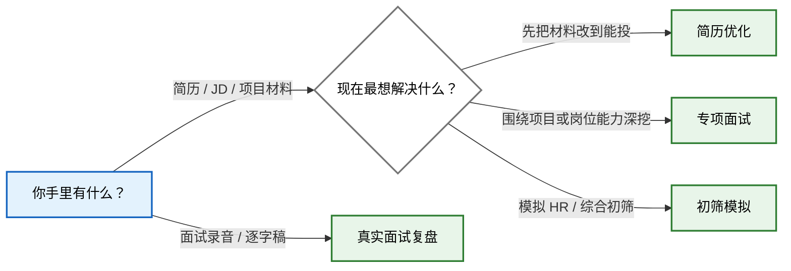

# ChengziCV Career Skills

> 4 个面向中文求职场景的 Agent Skills：改简历、练专项面试、做初筛模拟、复盘真实面试。

每个 Skill 都可以单独使用。把手头的简历、JD、项目材料或面试记录交给对应入口，就能直接开始。

## 这套 Skills 能帮你完成什么？

四个入口各做一件事：

| 你的任务 | 使用的 Skill | 你会得到 |
| --- | --- | --- |
| 整理或改写简历与配套材料 | `chengzicv-resume` | 一版能投的简历；经历证据不够时，再一题题补齐 |
| 针对项目、岗位知识或业务 Case 连续深挖 | `chengzicv-interview-practice` | 连续追问；问清后再反馈、讲解和复测 |
| 完成一场五题左右的企业初筛模拟 | `chengzicv-interview-mock` | 一场短模拟、企业视角复盘和针对性复练 |
| 复盘已经发生的真实面试 | `chengzicv-interview-review` | 逐题还原、表现诊断和下一次可以怎么答 |

## 我现在该选哪个入口？

这张图只解决一个问题：你现在该从哪个 Skill 开始。



- 简历优化：`$chengzicv-resume`
- 专项面试：`$chengzicv-interview-practice`
- 初筛模拟：`$chengzicv-interview-mock`
- 真实面试复盘：`$chengzicv-interview-review`

不用按固定顺序走。眼下需要什么，就从哪个入口开始。

## 快速开始

在支持 Agent Skills 的工具中运行：

```bash
npx -y skills add chengzicv/chengzicv-career-skills -g --all
```

安装后，可以这样开始：

```text
用 $chengzicv-resume 看这份简历和 JD。先给我一版能投的，再告诉我哪段经历最值得补证据。

用 $chengzicv-interview-practice 根据我的简历直接开始专项面试。先考后教，一次只问一个问题。

用 $chengzicv-interview-mock 根据我的简历开始一场企业初筛模拟。

用 $chengzicv-interview-review 复盘这份面试逐字稿。先告诉我表现，再把问题和回答逐题整理出来。
```

## 它会不会替我编经历？

不会。经历、数字、结果和个人贡献，只能来自你提供的材料或现场回答。

- 简历里的待确认信息和教学案例，不会被当成真实经历。
- 面试诊断尽量回到你的原话，不凭表达印象下结论。
- 没问到的能力不会被直接判低分。
- 通用参考答案不会被倒写成你的项目做法。

## 隐私数据会保存到哪里？

这些 Skill 不包含真实候选人数据，也不会自行把材料保存到本地。普通聊天只使用当前对话里能看到的内容；如果接入其他产品，数据怎么保存由对应产品决定。

求职材料通常包含姓名、电话、邮箱、教育经历和工作记录。使用前请确认所用平台的数据政策，不要把未脱敏的候选人材料提交到不受信任的服务，也不要把真实面试记录直接提交到公开 issue、公开日志或示例文件中。

## 使用边界

- 这是候选人训练与材料整理工具，不代表任何企业的内部录用标准。
- 不输出录用概率，也不承诺使用后一定通过面试。
- 不依据性别、年龄、籍贯、婚育、健康、民族、宗教或政治倾向作负面判断。
- 初筛模拟不替代算法、编码、系统设计或岗位专家 Case。
- 涉及时效性规则、法律、财税、平台政策或其他高风险专业判断时，应先核验可靠来源。
- AI 生成内容仍需人工核对，尤其是数字、个人贡献、技术实现和可外发材料。

## 项目结构

```text
.
├── chengzicv-resume/
├── chengzicv-interview-practice/
├── chengzicv-interview-mock/
├── chengzicv-interview-review/
└── README.md
```

每个目录中的 `SKILL.md` 定义触发条件和核心工作流；`references/` 保存按需加载的方法与模板；`scripts/`、`schemas/` 和 `runtime/` 只在对应 Skill 需要确定性校验或产品集成时使用。

## 许可证

本项目采用 [MIT License](LICENSE)。
