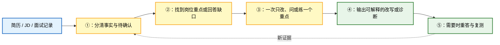
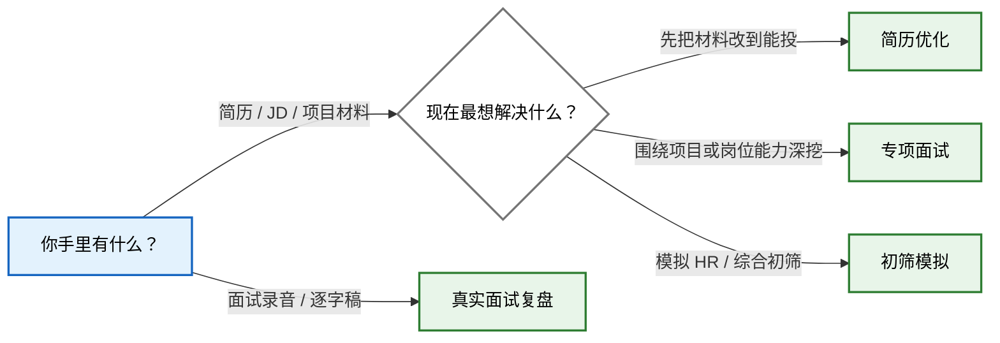

# ChengziCV Career Skills

> 4 个面向中文求职场景的 Agent Skills：改简历、练专项面试、做初筛模拟、复盘真实面试。

每个 Skill 都可以单独使用。把手头的简历、JD、项目材料或面试记录交给对应入口，就能直接开始。

## 为什么值得用这套 Skills？

它解决的不是“帮我把话写漂亮”，而是三个更难的问题：**哪些经历是真的、目标岗位在意什么、下一次怎样答得更稳。**

- **不替你编经历**：数字、结果、个人贡献和技术实现都要能回到你的材料或回答。
- **先给可用结果，再补关键证据**：简历材料足够时先出能投的版本，不用先回答一长串问题。
- **一次只处理一个问题**：减少同时组织多段答案的压力，也让追问能跟着你的真实回答变化。
- **不只点评，还会复练**：专项训练遵循“先考—反馈—讲解—重答—变式复测”，直到确认你真的会了。
- **诊断可以追溯**：模拟面试和真实面试复盘尽量引用原话；没有问到的能力只标记为证据不足，不直接判低分。
- **四个入口彼此独立**：只改简历、只练一场面试或只复盘一份录音都可以，不必走完整套流程。

## 它和普通求职提示词有什么不同？

普通提示词通常追求“一次生成一份看起来不错的答案”；这套 Skills 更重视结果能不能被候选人解释、被面试官继续追问。

| 常见做法 | ChengziCV 的做法 |
| --- | --- |
| 根据职位描述补出一套漂亮经历 | 先建事实边界，证据不够就降级表达或继续追问 |
| 一次抛出整套 STAR 问题 | 每次只问一个问题，并允许选择、跳过或只补一句 |
| 使用固定题库从头问到尾 | 根据简历、JD 和现场回答动态选择下一问 |
| 面试结束后给泛泛优缺点 | 判断回到原话，区分事实、推测、冲突和证据不足 |
| 给出标准答案后就结束 | 先让你作答，再针对缺口教学，最后换一种问法复测 |
| 把通用案例改写成候选人经历 | 案例只帮助理解和回忆，不自动进入简历或面试事实 |

## 它具体怎样工作？

四个 Skill 的任务不同，但底层都沿着同一条证据链工作：



这里的核心不是固定话术，而是闭环：先识别证据，再做判断；判断之后还要通过重答或复测确认是否真的改善。

## 这套 Skills 能帮你完成什么？

四个入口各做一件事：

| 你的任务 | 使用的 Skill | 你会得到 |
| --- | --- | --- |
| 整理或改写简历与配套材料 | `chengzicv-resume` | 一版能投的简历；经历证据不够时，再一题题补齐 |
| 针对项目、岗位知识或业务 Case 连续深挖 | `chengzicv-interview-practice` | 连续追问；问清后再反馈、讲解和复测 |
| 完成一场五题左右的企业初筛模拟 | `chengzicv-interview-mock` | 一场短模拟、企业视角复盘和针对性复练 |
| 复盘已经发生的真实面试 | `chengzicv-interview-review` | 逐题还原、表现诊断和下一次可以怎么答 |

## 我现在该选哪个入口？

这张图只解决一个问题：你现在该从哪个 Skill 开始。



- 简历优化：`$chengzicv-resume`
- 专项面试：`$chengzicv-interview-practice`
- 初筛模拟：`$chengzicv-interview-mock`
- 真实面试复盘：`$chengzicv-interview-review`

不用按固定顺序走。眼下需要什么，就从哪个入口开始。

## 怎么安装？

把下面这段话直接发给你正在使用的 AI Agent：

```text
请帮我安装这个仓库里的全部 Skills：
https://github.com/chengzicv/chengzicv-career-skills

请安装到当前客户端的全局 Skills 目录。优先使用 skills CLI，并自动识别当前客户端：
npx -y skills add chengzicv/chengzicv-career-skills --skill '*' -g -a <当前客户端>

安装后请确认 4 个 Skill 都能被识别，并告诉我如何调用它们。如果你不能直接执行命令，请给我适合当前客户端的准确安装步骤。
```

安装完成后重启客户端，再用 `$chengzicv-...` 调用。

## 安装后怎么开始？

不需要背复杂指令，交材料并说清当前目标即可：

```text
用 $chengzicv-resume 看这份简历和 JD。先给我一版能投的，再告诉我哪段经历最值得补证据。

用 $chengzicv-interview-practice 根据我的简历直接开始专项面试。先考后教，一次只问一个问题。

用 $chengzicv-interview-mock 根据我的简历开始一场企业初筛模拟。

用 $chengzicv-interview-review 复盘这份面试逐字稿。先告诉我表现，再把问题和回答逐题整理出来。
```

## 推荐什么客户端和模型？

只推荐下面三种选择，并尽量使用高强度推理：

| 选择 | 推荐组合 | 设置 |
| --- | --- | --- |
| 1 | Claude Code + 当前最新的 Claude Opus 或 Sonnet | 开启 Thinking，选择 `High` 或 `Max` |
| 2 | Codex + 当前最新的 GPT 旗舰模型 | 选择 `High` 或 `Max` 推理强度 |
| 3 | 国内 Agent 客户端 + DeepSeek、Kimi 或 Qwen 的最新旗舰模型，例如 DeepSeek V4 Pro、Kimi K3、Qwen Max | 开启 Thinking，选择 `High`、`Max` 或最高思考强度 |

其他客户端与模型组合暂不推荐。尤其不建议使用不支持完整安装 Skills、读取配套文件和持续执行多轮工作流的普通聊天模式。

## 它会不会替我编经历？

不会。经历、数字、结果和个人贡献，只能来自你提供的材料或现场回答。

- 简历里的待确认信息和教学案例，不会被当成真实经历。
- 面试诊断尽量回到你的原话，不凭表达印象下结论。
- 没问到的能力不会被直接判低分。
- 通用参考答案不会被倒写成你的项目做法。

## 隐私数据会保存到哪里？

这些 Skill 不包含真实候选人数据，也不会自行把材料保存到本地。普通聊天只使用当前对话里能看到的内容；如果接入其他产品，数据怎么保存由对应产品决定。

求职材料通常包含姓名、电话、邮箱、教育经历和工作记录。使用前请确认所用平台的数据政策，不要把未脱敏的候选人材料提交到不受信任的服务，也不要把真实面试记录直接提交到公开 issue、公开日志或示例文件中。

## 使用边界

- 这是候选人训练与材料整理工具，不代表任何企业的内部录用标准。
- 不输出录用概率，也不承诺使用后一定通过面试。
- 不依据性别、年龄、籍贯、婚育、健康、民族、宗教或政治倾向作负面判断。
- 初筛模拟不替代算法、编码、系统设计或岗位专家 Case。
- 涉及时效性规则、法律、财税、平台政策或其他高风险专业判断时，应先核验可靠来源。
- AI 生成内容仍需人工核对，尤其是数字、个人贡献、技术实现和可外发材料。

## 项目结构

```text
.
├── chengzicv-resume/
├── chengzicv-interview-practice/
├── chengzicv-interview-mock/
├── chengzicv-interview-review/
└── README.md
```

每个目录中的 `SKILL.md` 定义触发条件和核心工作流；`references/` 保存按需加载的方法与模板；`scripts/`、`schemas/` 和 `runtime/` 只在对应 Skill 需要确定性校验或产品集成时使用。

## 许可证

本项目采用 [MIT License](LICENSE)。
