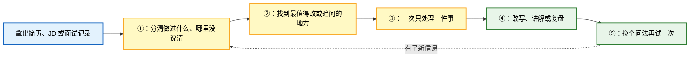
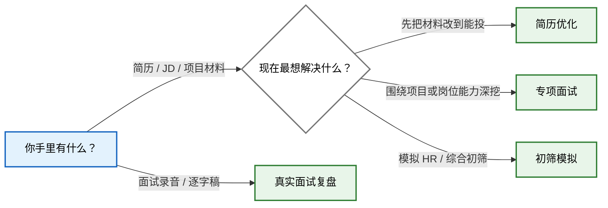

# ChengziCV Career Skills

> 4 个面向中文求职场景的 Agent Skills：改简历、练专项面试、做初筛模拟、复盘真实面试。

每个 Skill 都可以单独使用。把手头的简历、JD、项目材料或面试记录交给对应入口，就能直接开始。

## 为什么做这套 Skills？

很多求职工具拿到简历就开始润色。句子是好看了，但里面哪些是你真做过的、数字怎么算的、面试官继续追问时怎么解释，往往没人管。

这套 Skills 的做法慢一点，也实在一点：先看你手里的材料，再看目标岗位会关心什么。简历能先改就先改，缺信息时一次只问一件事；面试先让你自己答，答完再追问、讲解和复测；复盘时尽量回到你的原话，不凭感觉下结论。

不知道可以说不知道，记不清可以跳过。它不会把参考案例里的数字塞进你的简历，也不会因为某项能力没问到，就直接说你不行。

## 它是怎么做的？

说白了，就是下面几步：



不是套一遍固定话术就结束。哪里没说清，就继续问哪里；学过的内容，再换个问法看看是不是真的会了。

## 这套 Skills 能帮你完成什么？

四个入口各做一件事：

| 你的任务 | 使用的 Skill | 你会得到 |
| --- | --- | --- |
| 整理或改写简历与配套材料 | `chengzicv-resume` | 一版能投的简历；经历证据不够时，再一题题补齐 |
| 针对项目、岗位知识或业务 Case 连续深挖 | `chengzicv-interview-practice` | 连续追问；问清后再反馈、讲解和复测 |
| 完成一场五题左右的企业初筛模拟 | `chengzicv-interview-mock` | 一场短模拟、企业视角复盘和针对性复练 |
| 复盘已经发生的真实面试 | `chengzicv-interview-review` | 逐题还原、表现诊断和下一次可以怎么答 |

## 我现在该选哪个入口？

这张图只解决一个问题：你现在该从哪个 Skill 开始。



- 简历优化：`$chengzicv-resume`
- 专项面试：`$chengzicv-interview-practice`
- 初筛模拟：`$chengzicv-interview-mock`
- 真实面试复盘：`$chengzicv-interview-review`

不用按固定顺序走。眼下需要什么，就从哪个入口开始。

## 怎么安装？

把下面这段话发给你正在使用的 AI Agent：

```text
帮我把这个仓库里的 4 个 Skills 安装到当前客户端：
https://github.com/chengzicv/chengzicv-career-skills

请全局安装。能用 skills CLI 就直接用；装好后检查 4 个 Skill 是否都能调用，并把调用名称告诉我。如果你不能替我执行，就给我一条适合当前客户端、可以直接复制运行的命令。
```

安装完成后重启客户端，再用 `$chengzicv-...` 调用。

## 安装后怎么开始？

不需要背复杂指令，交材料并说清当前目标即可：

```text
用 $chengzicv-resume 看这份简历和 JD。先给我一版能投的，再告诉我哪段经历最值得补证据。

用 $chengzicv-interview-practice 根据我的简历直接开始专项面试。先考后教，一次只问一个问题。

用 $chengzicv-interview-mock 根据我的简历开始一场企业初筛模拟。

用 $chengzicv-interview-review 复盘这份面试逐字稿。先告诉我表现，再把问题和回答逐题整理出来。
```

## 推荐什么客户端和模型？

这套 Skills 比较吃模型。只推荐三种用法：

1. **Claude Code**：选当前最新的 Claude Opus 或 Sonnet，打开 Thinking，强度选 `High` 或 `Max`。
2. **Codex**：选当前最新的 GPT 模型，推理强度选 `High` 或 `Max`。
3. **国内客户端**：优先选 Qwen Max 或 DeepSeek Pro 的最新版本，并打开 Thinking 或最高思考强度。Kimi K3 放在其次；按我们的实际测试，Kimi 偶尔会补出材料里没有的事实，用完要多核对一次数字、结果和个人贡献。

目前不推荐豆包、元宝等模型或普通聊天入口。它们如果不能完整安装 Skill、读取仓库里的配套文件，就算模型名字一样，也可能只执行了最外面那几句话。

## 它会不会替我编经历？

不会。经历、数字、结果和个人贡献，只能来自你提供的材料或现场回答。

- 简历里的待确认信息和教学案例，不会被当成真实经历。
- 面试诊断尽量回到你的原话，不凭表达印象下结论。
- 没问到的能力不会被直接判低分。
- 通用参考答案不会被倒写成你的项目做法。

## 隐私数据会保存到哪里？

这些 Skill 不包含真实候选人数据，也不会自行把材料保存到本地。普通聊天只使用当前对话里能看到的内容；如果接入其他产品，数据怎么保存由对应产品决定。

求职材料通常包含姓名、电话、邮箱、教育经历和工作记录。使用前请确认所用平台的数据政策，不要把未脱敏的候选人材料提交到不受信任的服务，也不要把真实面试记录直接提交到公开 issue、公开日志或示例文件中。

## 使用边界

- 这是候选人训练与材料整理工具，不代表任何企业的内部录用标准。
- 不输出录用概率，也不承诺使用后一定通过面试。
- 不依据性别、年龄、籍贯、婚育、健康、民族、宗教或政治倾向作负面判断。
- 初筛模拟不替代算法、编码、系统设计或岗位专家 Case。
- 涉及时效性规则、法律、财税、平台政策或其他高风险专业判断时，应先核验可靠来源。
- AI 生成内容仍需人工核对，尤其是数字、个人贡献、技术实现和可外发材料。

## 项目结构

```text
.
├── chengzicv-resume/
├── chengzicv-interview-practice/
├── chengzicv-interview-mock/
├── chengzicv-interview-review/
└── README.md
```

每个目录中的 `SKILL.md` 定义触发条件和核心工作流；`references/` 保存按需加载的方法与模板；`scripts/`、`schemas/` 和 `runtime/` 只在对应 Skill 需要确定性校验或产品集成时使用。

## 许可证

本项目采用 [MIT License](LICENSE)。
