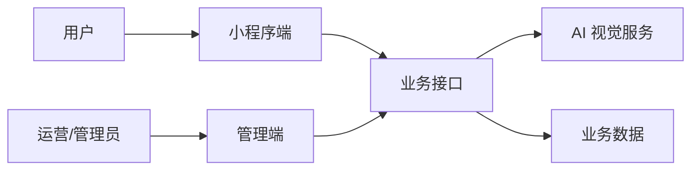

# 飞书项目双文档交付规范

本文件规定如何把简历、聊天记录、JD、项目 PPT/PDF、系统截图、演示视频和补充材料整理成两份可在飞书阅读的项目文档：一份项目复盘与面试准备手册，一份可直接发送给招聘方的项目作品集。

核心目标不是把素材堆进文档，而是让候选人沿着一条清晰的因果链理解项目：为什么做、系统怎样工作、自己具体做了什么、遇到什么问题、如何验证，以及面试官会怎样追问。

## 1. 什么时候必须读取本文件

出现以下任一情形时读取本文件：

- 用户给出截图、视频、PPT、PDF、压缩包或项目说明，要求做作品集。
- 用户要求在改完多方向简历后，同步生成对应项目材料。
- 用户明确要飞书文档、项目复盘手册、面试准备手册或图文项目文档。
- 简历中的技术项目较强，但一页简历无法容纳实现过程和追问准备。
- 用户一次性提供全部材料，并要求无需继续追问、直接完成整套交付。

若只有简历，没有任何可验证的项目素材，也可以生成内部准备手册，但不能把行业常识写成候选人已经完成的功能或成果。

## 2. 固定交付两份文档

只要用户提供了可验证的项目材料并要求完整交付，默认同时生成两份文档；只有用户明确缩小范围时才减少。两份文档共享同一份事实台账和“事实型正文核心”，但不能从准备手册机械删除几段后冒充外发作品集。

| 文档 | 主要读者 | 写作目标 | 可包含内容 |
| --- | --- | --- | --- |
| 项目复盘与面试准备手册 | 候选人本人，也应基本经得起面试官阅读 | 理解项目并形成可直接复用的表达 | 事实型正文核心、实现脉络、难点、排查与验证、追问知识、核验清单 |
| 求职作品集 | 招聘方/面试官 | 快速验证项目价值和个人贡献 | 精选成果、关键截图、真实技术动作、可验证交付物 |

### 2.1 事实型正文核心

两份文档中关于项目背景、系统结构、个人职责、功能链路、截图解析和已验证结果的内容应来自同一事实源，并采用候选人第一人称或客观项目叙述。标题、段落和图片说明直接按面试官可读标准撰写，候选人无需再把“教学话术”改成“作品集话术”。

### 2.2 准备手册的增量内容

准备手册是在事实型正文核心后增加学习深度，而不是改成教案。可增加常见实现逻辑、问题定位、测试思路和追问知识，但必须满足：

- 已有事实仍用可直接外发的候选人表达。
- 未经材料支持的知识只能作为理解、核验或下一步方案，不能伪装成已完成事实。
- 希望用户学会后直接复制的内容，单独给出“核验通过后可直接使用”的完整候选人段落；段落本身不含顾问口吻，但复制前必须完成对应核验。

### 2.3 外发作品集必须独立生成

外发作品集每次都从事实台账、素材索引和事实型正文核心重新生成。不得把准备手册中的常见实现、模拟排障、未来方案或未核验表达通过“删掉提示词”迁入外发文档。

内部手册也要像正式知识文档，不在正文展示“已确认事实”“PPT 展示口径”“推测”“待确认”“顾问建议”等后台标签。事实状态只保留在后台事实台账中。

## 3. 输入材料如何归档

先按 `workflow.md` 和 `fact-ledger.md` 建立来源与事实台账，再额外建立一张素材索引：

```text
素材1：演示视频——可展示完整用户路径
素材2：小程序首页截图——可证明入口和主要业务对象
素材3：识别结果页——可证明模型结果如何进入业务流程
素材4：管理端列表——可证明数据管理与审核能力
素材5：比赛 PPT——可提取模型、指标、分工和方案图
```

素材索引至少记录：

- 文件路径或来源。
- 内容类型：视频、截图、PPT、PDF、代码、文档。
- 能证明什么。
- 是否包含姓名、手机号、学号、聊天、密钥等隐私。
- 最适合放在哪个章节。
- 是否需要裁剪、转码或重新导出。

不要把重复截图全部上传。优先选择能形成“入口 → 核心处理 → 结果 → 管理闭环”的证据链。

## 4. 标题和文件命名

### 4.1 文档标题

内部手册优先使用：

```text
{姓名}-{项目名}项目复盘与面试准备手册
```

项目唯一且上下文明确时可简化为：

```text
{姓名}-项目复盘与面试准备手册
```

外发作品集优先使用：

```text
{姓名}-{岗位方向}求职作品集
{姓名}-{项目名}项目作品集
```

文件名与飞书标题保持一致，不使用“最终版”“最新版2”“修改版”等不可追踪名称。

### 4.2 章节标题

标题采用 Knowledge Capture 的命名方式：标题本身要说明读者的问题、候选人的判断或知识关系，正文第一句立即给结论。准备手册的事实型正文与外发作品集使用同一套标题语言。

优先使用问题句：

```text
## 一句话讲明白这个项目
## 从图片输入到结果页面的处理链路
## 我在三人团队中的工作范围
## 我是如何判断模型优化是否成功的
## 管理端如何支持数据查询与维护
```

也可以使用结论句：

```text
## 识别结果继续进入鉴别报告与知识服务
## 我的职责集中在前端交互、接口联调和结果呈现
```

避免只有分类、没有信息的标题：

```text
这份文档怎么使用
一分钟如何讲清楚这个项目
用户拍照后，系统发生了什么
如何判断模型真的在变好
面试时怎么讲
项目介绍
技术方案
系统优化
项目总结
```

需要保留分类时，把对象和问题补全：

```text
一分钟如何讲清楚这个项目 → 一句话讲明白这个项目
用户拍照后，系统发生了什么 → 从图片输入到结果页面的处理链路
如何判断模型真的在变好 → 我是如何判断模型优化是否成功的
项目介绍 → 项目从视觉识别延伸到知识服务与后台管理
技术方案 → 图片识别链路如何连接模型与结果页面
系统优化 → 我如何定位并改善识别等待体验
项目总结 → 项目最终形成了哪些可核验交付物
```

外发作品集和准备手册的事实型正文都不得出现“怎么使用这份文档”“面试时应该怎么说”“建议候选人补充”等顾问视角标题。确有内部学习内容时，集中放在准备手册后半部分的“深入理解与核验”章节，不打断前面的作品展示链路。

### 4.3 图片标题

图片标题不写“图1”“页面截图”，而写读者应该看见的证据：

```text
识别入口把拍照、相册选择和历史记录集中在一个页面
结果页同时展示识别类别、置信度和后续操作
管理端支持按状态筛选并回看原始图片
```

## 5. 两份文档共用的正文顺序

准备手册和外发作品集的事实型正文默认按下面顺序组织。材料明显不适用时可以删减，但不要打乱“先全局、后局部；先看结果、后讲实现；最后呈现交付证据”的认知顺序。

### 5.1 封面后立刻放演示视频

顺序应为：

```text
H1 文档标题
演示视频
一句话视频说明
```

视频说明只描述内容，不写使用指导，例如：

```text
演示视频覆盖用户上传图片、获得识别结果，以及管理端查看与维护数据的完整流程。
```

视频较大或编码不兼容时，保留原文件，并额外生成兼容版本；飞书中使用实际附件或可播放视频块，不只写本地路径。

### 5.2 先用“一句话讲明白这个项目”完成速览

速览直接回答：

- 项目给谁用、解决什么问题。
- 系统包含哪几个端和核心模块。
- 自己在团队中的角色和职责边界。
- 最有含金量的 2—3 个技术或交付点。
- 项目获得什么真实结果：比赛、答辩、演示、上线或验收。

准备手册可以在事实型速览之后补一段 60 秒自然介绍；外发作品集保留更精炼的项目概述，不出现“面试话术”“背诵模板”等标签。

### 5.3 再画一张系统全景图

全景图只回答一个问题：系统由哪些对象组成，它们如何连接。

推荐结构：



图后用 3—5 句解释边界，不重复读图。

### 5.4 单独画个人职责地图

团队项目必须把“项目做了什么”和“候选人做了什么”分开。职责地图至少分为：

- 独立完成或主要承担。
- 与队友协作完成。
- 了解但不是本人负责。

飞书正文不必展示事实状态标签，但要用自然语言说清边界，例如“我主要承担……；模型训练由队友负责，我参与了结果联调和展示”。

### 5.5 按用户任务拆核心链路

每条链路采用：

```text
用户目标
→ 关键步骤
→ 对应截图
→ 系统处理
→ 异常或难点
→ 解决方式
→ 验证方法
```

常见链路包括：

- 登录与身份进入。
- 图片上传、拍照或文件导入。
- AI 识别与结果返回。
- 结果确认、保存和历史记录。
- 管理端查询、筛选、编辑、审核或导出。
- 错误提示、空状态和重试。

### 5.6 用“证据单元”讲每个高价值功能

外发作品集中的每个核心功能按下面的固定单元撰写：

```text
## 能说明候选人判断或项目关系的标题

一句话结论。

[关键截图]

图片解析：这张图证明了什么，用户在这里完成什么动作。

个人动作与实现脉络：候选人负责什么，前端、接口、数据或模型之间怎样协作。

真实难点与处理：只写材料支持或用户确认的约束、异常、兼容、性能或协作问题。

结果与验证：怎样判断功能、模型或交付物达到预期。
```

正文要写“对象 + 动作 + 机制 + 验证”，不要只写“实现了上传功能”“进行了优化”。

准备手册先完整保留上述证据单元，再在对应章节之后增加学习扩展：

```text
### 深入理解与核验

实现知识：解释常见机制、排查顺序或测试方法。

核验清单：指出需要从代码、配置、日志、PPT 或队友记录中确认的项目细节。

核验通过后可直接使用：给出一段完整的候选人第一人称表达；这段表达只有在核验通过后才能复制进外发作品集。
```

不得把“面试官可能追问”“建议这样回答”等培训标题夹在事实型正文中。需要追问准备时，集中放到准备手册后半部分。

### 5.7 再讲测试、协作和交付

功能讲完后，补三类工程证据：

- 测试：正常流程、边界情况、失败重试、空数据、重复提交、权限或兼容。
- 协作：接口字段确认、分支合并、联调顺序、问题记录、版本交付。
- 交付：演示视频、比赛 PPT、系统截图、测试记录、部署/运行说明。

没有正式测试平台时，可以写手工验证路径和验收清单，不虚构自动化测试体系。

### 5.8 准备手册最后增加深入理解与核验

结尾至少包含：

1. 60 秒项目介绍。
2. 3 分钟完整讲法。
3. 8—12 个高频追问及回答要点。
4. 角色边界容易说大的地方。
5. 面试前需要自己补看的技术知识。
6. 能现场打开的演示、截图和文件清单。

回答要点用于理解，不生成统一背诵稿；候选人必须能用自己的话解释。外发作品集到 5.7 的真实交付证据即可结束，不附追问、练习、角色风险或补课清单。

## 6. 图片如何选、放、讲

### 6.1 选择标准

每张图片至少满足一项：

- 证明一个核心功能真实存在。
- 证明用户路径是完整的。
- 证明候选人的具体交付物。
- 能引出一个有价值的实现或排障过程。
- 能证明管理、测试或交付闭环。

通常精选 7—12 张即可。重复页面、纯装饰页、无法看清内容的截图不放。

### 6.2 摆放规则

- 图片紧跟在相关结论之后，不单独建立“截图相册”。
- 每张图前告诉读者为什么看，图后解释它证明什么。
- 一张图只承担一个主要结论；信息过密时裁剪或拆图。
- 同一链路的 2—4 张图可以横向/连续排列，但必须有步骤说明。
- 重要界面尽量保留原始比例；长页面只截与结论有关的部分。

### 6.3 图片解析模板

```text
这张图展示……，用户可以在这里完成……。

在我负责的部分，页面先……，再通过……，最后把……呈现出来。

项目中遇到的主要问题是……。我通过……处理，并用……验证结果。
```

不要把模板机械复制到每张图；根据真实功能改成自然段。若“问题—处理—验证”没有材料支持，外发作品集只保留功能事实与个人动作，不用常见问题补齐。

### 6.4 隐私和安全

上传前必须检查并处理：

- 手机号、邮箱、身份证、学号、详细住址。
- 私人聊天、群成员信息、候选人或客户信息。
- Token、密钥、数据库地址、内网域名。
- 未公开比赛材料或仍受保密约束的内容。

必要时裁剪、打码或用局部截图，不为排版牺牲隐私。

## 7. 图应该怎样画

只有关系、顺序、分支或边界用文字不易看懂时才画图。通常一份完整手册保留 3—5 张高价值图：

1. 系统全景图：端、服务、数据和角色。
2. 核心业务流程图：用户动作到系统结果。
3. 个人职责地图：本人、队友和协作边界。
4. 关键模块实现图：例如识别、RAG、审核或数据处理链路。
5. 问题排查图：现象、定位、修复、验证。

绘图遵守以下规则：

- 一张图只回答一个问题。
- 节点使用 2—8 个汉字的短语；长解释放在图后。
- 主链路优先从左到右，复杂分组使用 `subgraph`。
- 箭头可以编号，帮助候选人按顺序讲述。
- 颜色只用于区分角色、端或状态，不做装饰。
- 飞书无法稳定渲染 Mermaid 时，先渲染为清晰 PNG/SVG 再上传。
- 可用时读取 `jc-markdown-visual-writer` 的 Mermaid 与文本结构规则，不重复发明图形语法。

## 8. 准备手册如何补足深度并保持可直接复用

内部手册允许补充“用于理解和面试准备的常见实现逻辑”，但不允许把它改写成候选人已经完成的事实。

### 8.1 可以补的内容

- 一个功能通常涉及的前端状态、接口字段和异常分支。
- 常见问题的排查顺序，例如先复现、再看请求、再核对返回、最后验证界面状态。
- 可用于解释设计取舍的对比，例如直接阻塞等待与异步反馈。
- 面试官可能追问的基础知识和回答框架。
- 下一版可以怎样继续完善，以及验证方案。

### 8.2 不能擅自补成事实的内容

- 没出现过的技术栈、模型、数据库或部署方式。
- 没证据的准确率、响应时间、用户数、数据量和提升比例。
- 没确认的个人职责、团队规模、决策权或主导关系。
- 不存在的上线、验收、客户使用或获奖结果。
- 企业级、高并发、分布式、工业级等超出学生项目边界的结论。

### 8.3 三层写法

准备手册对每个需要补课的模块采用三层写法：

```text
第一层｜事实型正文：项目中实际采用……，我负责……，结果通过……验证。

第二层｜深入理解与核验：解释常见机制，并列出需要回看代码、配置、PPT 或演示的证据。

第三层｜核验通过后可直接使用：我先……，随后……，最后通过……确认优化有效。
```

第一层可以原样进入两份文档。第二层只留在准备手册。第三层的候选人段落不需要再改写，但只有用户真正学会、能够解释并完成证据核验后，才允许复制进外发作品集。

内部补充内容不得自动迁入外发简历或作品集。外发版本必须重新对照事实台账生成，不能通过删除“可能、建议、如果”等限定词把未证实内容变成完成事实。

## 9. 飞书发布流程

### 9.1 先完成本地源稿

先在交付文件夹生成 Markdown 源稿和素材目录，再发布到飞书。推荐目录：

```text
交付-作品集/
├── 姓名-项目复盘与面试准备手册-飞书版.md
├── 姓名-项目名-项目作品集-飞书版.md
├── 飞书作品集链接.md
└── 素材/
    ├── 原始截图/
    ├── 精选截图/
    ├── 图解/
    └── 视频/
```

本地源稿是可恢复版本；飞书是发布版本。不要只在飞书在线编辑而不留源稿。

### 9.2 分别创建或导入两份飞书文档

推荐顺序：

1. 用飞书应用/CLI 分别创建或导入准备手册和外发作品集两个 `docx`，不要让两个链接指向同一份混合文档。
2. 两份文档都保持 H1 标题为第一个正文块。
3. 把演示视频作为真实文件块放在标题之后；外发作品集优先使用可直接播放的预览样式。
4. 按正文位置上传精选图片和图解，不保留本地路径占位符。
5. 外发作品集先跑受众隔离和事实审计，再检查目录层级、表格、图片清晰度与媒体位置。
6. 准备手册检查事实型正文是否与外发版同口径，并确认学习扩展没有冒充完成事实。
7. 设置用户要求的公开阅读或协作者权限。
8. 应用代建文档时，把两份文档的所有权都转给用户账号；如需后续维护，为应用保留可管理权限。
9. 把两个最终链接和各自发布状态写回本地交付文件。

### 9.3 授权与所有权

- OAuth 回调报“重定向 URL 有误”时，不让用户反复刷新；先检查应用后台登记的回调地址与 CLI 实际回调是否完全一致。
- 能使用租户身份完成的发布，不强迫用户走无必要的 OAuth。
- 转移所有权前，用应用所有者/协作者信息与通讯录信息双重确认目标用户。
- 转移后再读取文件元数据，确认 `owner_id` 已变成目标用户；只看到 `full_access` 不能代替所有权核验。
- 不在交付文档或日志里写入 App Secret、Access Token 或其他凭据。

### 9.4 发布后的结构验收

发布后必须检查：

- 标题正确，视频位于最前方。
- 章节顺序与源稿一致。
- 图片、图解、附件均为实际飞书块，不是失效路径或占位文字。
- 没有重复导入、空标题、孤立图片或损坏表格。
- 文档权限符合要求，所有权属于指定用户。
- 链接可打开；公开链接按无登录环境再测一次。
- 外发作品集不含“怎么使用、面试准备、模拟追问、建议补充、待确认、顾问说明”等内部语言。
- 准备手册的事实型正文使用候选人/项目表达，用户复制到外发版时不需要重新改口吻。

当单次写入受块数或层级限制时，可以采用“先导入主体、再替换媒体占位”的方式；若旧文档无法可靠修复，新建完整文档并在旧文档放清晰跳转说明。

## 10. 简历与作品集如何保持一致

每份岗位简历只选择与该方向相关的项目角度，但不能改变同一事实：

- 行政/信息管理方向突出资料整理、后台维护、数据准确和协作交付。
- 新媒体/运营方向突出用户流程、内容呈现、活动或传播素材。
- 实施/测试/技术支持方向突出需求理解、接口联调、问题排查、测试和交付。
- 技术方向突出真实技术栈、模块实现、数据处理、模型或系统边界。

作品集可以比简历更详细，但项目名、时间、角色、团队规模、技术栈、结果和奖项必须与各版本简历一致。

## 11. 默认交付清单

用户一次性给出完整材料并要求“直接做完”时，默认交付：

1. 按岗位方向拆分的完整版简历。
2. 每个方向的内部优化说明与投递建议。
3. 一份项目复盘与面试准备手册本地源稿。
4. 一份严格基于可核验事实的项目作品集本地源稿。
5. 两份分别发布并绑定媒体的飞书文档。
6. 两个飞书链接及各自的权限、媒体和所有权状态文件。
7. 精选图片、图解和兼容视频等可复用素材。

如果用户明确只要其中一部分，按用户范围缩减。

## 12. 最终验收清单

### 内容

- 候选人能否在 60 秒内说清项目价值、个人角色和最强证据？
- 两份文档是否都从全局到局部，再落到真实交付证据？
- 每个高价值功能是否都有截图与解析，并在材料支持时补充实现、难点、处理和验证？
- 常见补充是否停留在准备语境，没有伪装成完成事实？
- 简历与作品集中的事实、技术栈和角色边界是否一致？
- 外发作品集是否从事实台账独立生成，而不是从准备手册机械删减？
- 准备手册的事实型正文是否已经使用面试官可读、可直接复制的候选人表达？

### 视觉

- 是否精选图片而非倾倒素材？
- 是否有 3—5 张真正帮助理解的图？
- 图片是否紧邻对应解析，标题是否说明证据？
- 图中文字是否清晰，流程方向是否统一？
- 视频是否位于文档最前方并可播放/下载？

### 飞书

- 是否保留本地 Markdown 源稿和素材目录？
- 两份文档中的图片和视频是否都已绑定为飞书块？
- 是否清除所有路径占位符？
- 两个链接是否可打开，权限是否符合用户要求？
- 应用代建时，是否已分别转移并核验两份文档所有权？
- 是否把两个链接与发布结果写回本地交付目录？

任一关键项失败，不算完整交付。
