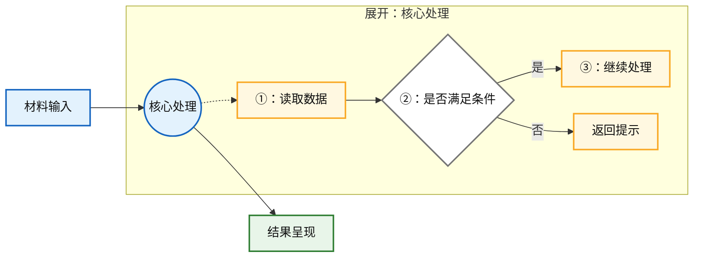

# 求职作品集视觉与绘图规范

本文件只服务项目复盘手册和外发作品集。它把通用可视化方法压缩成作品集需要的图形选型、布局、兼容性和验收规则，不依赖其他 Skill。

## 目录

- 先决定是否画图
- 五类作品集图怎么选
- 主线与细节的固定结构
- 颜色与间距
- Mermaid 兼容性
- 文本兜底
- 飞书交付验收

## 先决定是否画图

只有关系、顺序、分支、角色边界或状态变化用一两句话讲不清时才画图。

- 三个以内的线性步骤：直接使用 `输入 → 处理 → 结果`。
- 多个条件对应不同结果：使用流程图或决策表。
- 多个角色来回调用：使用时序图。
- 只是列举功能、成果或材料：使用列表或表格，不画图。
- 没有材料支持的技术实现不进入图；图中的节点和连线同样受事实台账约束。

## 五类作品集图怎么选

| 要回答的问题 | 首选结构 | 使用要点 |
| --- | --- | --- |
| 整个系统怎样组成 | `graph LR` + `subgraph` | 主线展示端、服务、数据和结果；只展开一个关键模块 |
| 用户从入口怎样走到结果 | `graph LR` | 保留4—7个主节点，条件写在连线上 |
| 我与队友分别负责什么 | 分组 `graph LR` 或职责表 | 以角色分组，不把团队成果全部连到本人 |
| 前端、接口、模型或后端怎样交互 | `sequenceDiagram` | 使用 `autonumber`，按真实角色和调用顺序画 |
| 问题怎样定位、处理和验证 | `flowchart TD` | 展示现象、判断、处理、验证及失败回退 |

状态图、ER 图和饼图不是作品集默认图种。只有材料确实包含复杂状态、实体关系或可核验比例时才使用。

## 主线与细节的固定结构

复杂图默认采用“所有读者都能看懂的主线＋一个可下钻的细节盒子”：

使用限制：

- 主线保持4—7个节点；超过时拆图，不缩成难以阅读的小字。
- 一张图最多重点展开一个模块；多个模块都要展开时分别画图。
- `-.->` 只表示“展开查看”，不能代替真实业务流向。
- 决策节点必须写出材料中的真实条件，不能只写“判断”“校验”。
- 图前用一句话说明它回答什么，图后写一句最重要的结论或候选人职责边界。

## 颜色与间距

### 颜色语义

- 蓝色：用户动作、业务主线或主要输入。
- 黄色：处理细节、内部步骤或需要解释的模块。
- 绿色：输出、完成状态或已验证结果。
- 白底灰边：判断节点、中性状态。
- 红色只用于真实风险、失败或阻断，不用于强调普通内容。

同一份作品集保持同一套颜色语义。颜色不能代替文字；黑白打印时仍应看懂角色和流向。

### 内边距与图间距

内边距的作用是让文字与节点边框之间留出呼吸空间，避免中文贴边、圈号拥挤或导出图片后显得像表格单元格。

- Mermaid 流程图默认使用 `padding: 12`；渲染器不支持时接受其默认值，不使用 HTML 空格伪造内边距。
- 同层节点默认 `nodeSpacing: 36`，层级之间默认 `rankSpacing: 48`。
- 节点文字超过两行时优先缩短或拆节点，不靠继续增加 padding 挽救长句。
- 图的外围留白由渲染器控制；导出后不得裁到箭头、标题、分组边框或阴影。
- 手机预览不放大也应能读清主线；细节过密时拆图，不单纯提高分辨率。

这些数值是作品集默认起点，不是普遍设计定律。渲染结果出现过松、过挤或横向过长时，以可读性调整，并保持同一文档一致。

## Mermaid 兼容性

- 节点和连线标签不能以 `1.`、`2.`、`- `、`* `、`+ ` 开头，避免被 Markdown 渲染器识别为列表。
- 需要编号时使用 `① ② ③`；超过20步必须拆图。
- `sequenceDiagram` 使用 `autonumber`，不再手写圈号。
- `graph` 和 `flowchart` 不使用小写 `end` 作为节点 ID。
- Mermaid 代码块只放 Mermaid，不混入解释段落。
- 节点使用2—8个汉字为主；技术名词可以保留，但整句说明放到图后。
- ` ` 只用于必要的两行标签，不把段落塞进节点。

## 文本兜底

Mermaid 没必要、渲染失败或当前客户端不稳定时，按内容选择：

- 有层级和分支：ASCII 树。
- 多条件对应多结果：决策表。
- 严格执行顺序：有序列表。
- 验收与待办：检查清单。

复杂逻辑优先保留“渲染图＋文本兜底”两种表达。文字兜底必须覆盖关键条件和结果，不能只写一句“见上图”。

## 飞书交付验收

1. 保留 Mermaid 或文本源稿，便于修改和重新渲染。
2. 飞书无法稳定渲染时，转成清晰 PNG 或 SVG，并上传为真实媒体块。
3. 导出图检查标题、箭头、分组边界、中文字体和圈号是否完整。
4. 在桌面端和手机端各预览一次；主线需要放大才能读时拆图重做。
5. 图片说明写清这张图证明什么，以及候选人负责哪一段。
6. 外发作品集不得出现事实编号、待确认标签、内部培训提示或未经证实的技术链路。
7. 图中的项目名、角色、技术栈和结果必须与简历及正文一致。
